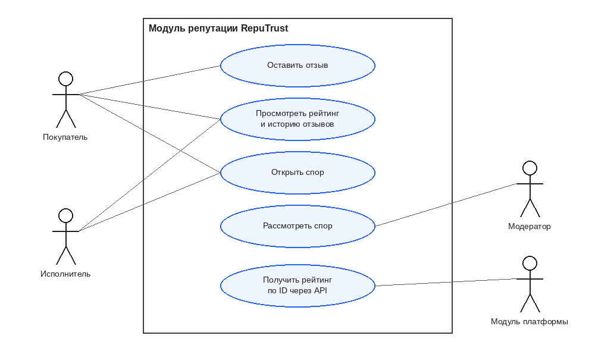
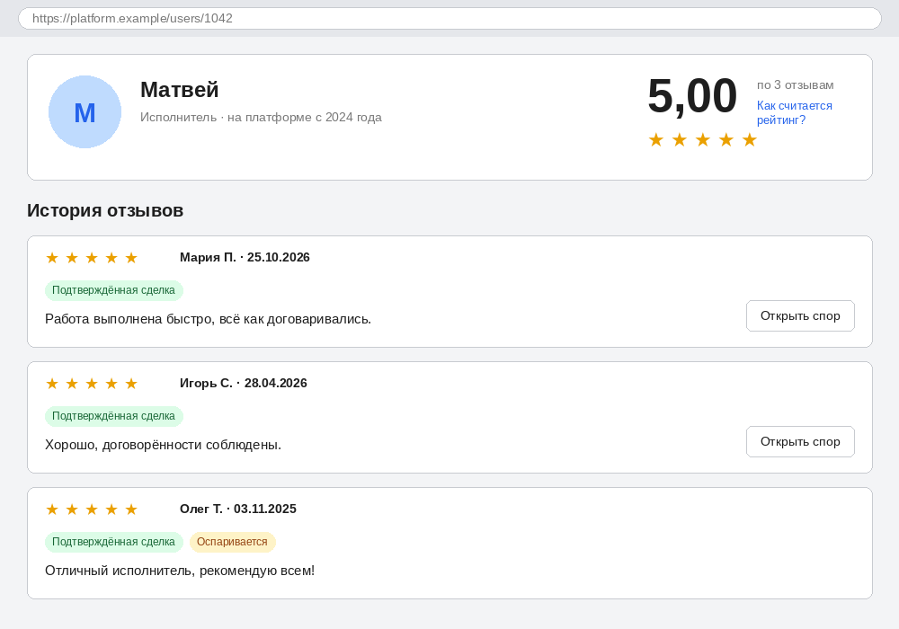
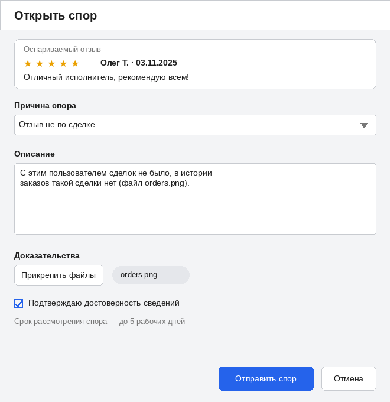
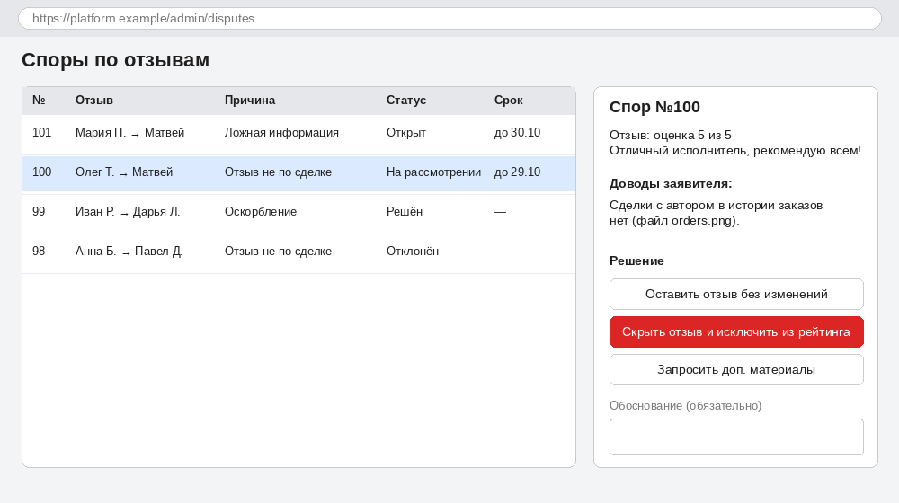

# RepuTrust — Концепция и границы проекта (бизнес-требования)

| Поле | Значение |
|---|---|
| Проект | RepuTrust — модуль репутации для онлайн-платформы услуг |
| Вариант задания | 7: модуль репутации |
| Тип проекта | Web-модуль (REST API + веб-формы) |
| Автор | Ермалович М.С., гр. 439401 |
| Заказчик (роль) | преподаватель |
| Дисциплина | Жизненный цикл разработки программного обеспечения |
| Версия документа | 0.1 (черновик для pull-request) |

## 1. Бизнес-требования

### 1.1. Исходные данные
На онлайн-платформе, где покупатели заказывают услуги у исполнителей, у новых клиентов нет способа понять, можно ли доверять исполнителю. Отзывы разбросаны по профилям, не имеют единого правила учёта, а спорные отзывы (ложные, оскорбительные, не по сделке) невозможно оспорить. RepuTrust — модуль платформы, который хранит историю отзывов, считает рейтинг пользователя, отдаёт его другим модулям через API и принимает споры по отзывам.

### 1.2. Бизнес-возможности
- Повысить доверие покупателей к исполнителям и, как следствие, число завершённых сделок.
- Сделать рейтинг справедливым: свежие отзывы важнее старых, оспоренные отзывы проверяются.
- Дать остальным модулям платформы (поиск, профили, рекомендации) единый источник рейтинга.

### 1.3. Бизнес-цели и критерии успеха

| ID | Бизнес-цель | Критерий успеха |
|---|---|---|
| BG-1 | Повысить доверие к исполнителям | Отзыв оставляют не менее 40 % покупателей после завершённой сделки в течение 3 месяцев после запуска |
| BG-2 | Обеспечить достоверность отзывов | Не менее 90 % споров получают решение за 5 рабочих дней |
| BG-3 | Дать другим модулям быстрый доступ к рейтингу | API возвращает рейтинг за 300 мс или быстрее (95-й процентиль) при 100 запросах в секунду |
| BG-4 | Обеспечить прозрачность | Для 100 % решений по спорам сохраняется обоснование, а пользователь видит историю своих отзывов и правило расчёта рейтинга |

### 1.4. Потребности заинтересованных лиц
- Покупатель: оставить отзыв по завершённой сделке и увидеть рейтинг исполнителя перед заказом.
- Исполнитель: видеть свой рейтинг и историю отзывов, оспорить несправедливый отзыв.
- Модератор: получать споры в одном списке, принимать решение и фиксировать обоснование.
- Владелец платформы: единое правило расчёта рейтинга и защита от накрутки.
- Другие модули платформы: получать рейтинг пользователя по его ID.

### 1.5. Бизнес-риски

| ID | Риск | Вероятность | Влияние | Меры |
|---|---|---|---|---|
| R-1 | Накрутка рейтинга фальшивыми отзывами | Средняя | Высокое | Принимать отзыв только по подтверждённой завершённой сделке; один отзыв на сделку |
| R-2 | Конфликты пользователей из-за рейтинга | Высокая | Среднее | Процедура спора с обоснованием решения |
| R-3 | Рост нагрузки на API при росте платформы | Средняя | Среднее | Критерий BG-3, кэширование рассчитанного рейтинга |
| R-4 | Расширение требований в ходе работы | Высокая | Среднее | Базовая версия требований, изменения через pull-request |
| R-5 | Отзывы содержат персональные данные | Средняя | Высокое | Соблюдать требования законодательства о защите персональных данных, хранить только необходимое |

## 2. Концепция решения

### 2.1. Концептуальное описание
RepuTrust подключается к платформе как отдельный модуль. Данные о пользователях и сделках он получает от платформы, отзывы и споры хранит сам. Диаграмма вариантов использования: 

### 2.2. Главные функции

| ID | Функция | Приоритет |
|---|---|---|
| F-1 | Хранение истории отзывов: оценка 1–5, текст, дата, автор, адресат, сделка; изменённые и скрытые отзывы сохраняются в истории | Высокий |
| F-2 | Расчёт рейтинга по среднему взвешенному (правило ниже) | Высокий |
| F-3 | API получения рейтинга по ID пользователя | Высокий |
| F-4 | Форма «Открыть спор» по отзыву с причиной, описанием и доказательствами | Высокий |
| F-5 | Рассмотрение споров модератором с обязательным обоснованием решения | Средний |
| F-6 | Страница профиля с рейтингом и историей отзывов | Средний |

#### Правило расчёта рейтинга (бизнес-правило, предварительное)
Рейтинг пользователя — среднее взвешенное оценок: R = Σ(wᵢ · sᵢ) / Σwᵢ, где sᵢ — оценка отзыва (1–5), wᵢ = 0,5^(tᵢ / 180), tᵢ — возраст отзыва в днях. Вес отзыва уменьшается вдвое каждые 180 дней. Скрытые по итогам спора отзывы в расчёте не участвуют.

Пример. Три отзыва: оценка 5 возрастом 0 дней (вес 1), оценка 4 возрастом 180 дней (вес 0,5), оценка 1 возрастом 360 дней (вес 0,25). R = (5·1 + 4·0,5 + 1·0,25) / (1 + 0,5 + 0,25) = 7,25 / 1,75 ≈ 4,14. Обычное среднее было бы 10 / 3 ≈ 3,33.

#### API получения рейтинга (бизнес-уровень)
Запрос: рейтинг по ID пользователя. Ответ: ID пользователя, рейтинг, число учтённых отзывов, дата последнего пересчёта. Для пользователя без отзывов рейтинг не определён. Доступ только для модулей платформы.

#### Процесс спора
Статусы: «Открыт», «На рассмотрении», «Решён», «Отклонён». Спор открывает автор или адресат отзыва. Решение модератора: оставить отзыв без изменений, скрыть отзыв, запросить дополнительные материалы. Срок решения — до 5 рабочих дней.

Макеты интерфейса:
- Профиль пользователя: 
- Форма «Открыть спор»: 
- Панель модератора: 

### 2.3. Предположения и зависимости
- Платформа предоставляет идентификатор пользователя, роль и факт завершённой сделки.
- Аутентификация и авторизация выполняются платформой.
- Интерфейс на русском языке.

## 3. Рамки и ограничения

### 3.1. Объём первого выпуска
F-1, F-2, F-3, F-4, F-5; F-6 — в упрощённом виде.

### 3.2. Объём последующих выпусков
График изменения рейтинга, уведомления о новых отзывах и спорах, ответ исполнителя на отзыв, антифрод-проверки отзывов.

### 3.3. Ограничения и исключения
- Не входят: регистрация пользователей, платежи, чат, мобильное приложение.
- Предпочтительные технологии: C++17, REST API, PostgreSQL, HTML-формы.
- Срок: один семестр, один разработчик.

## 4. Бизнес-контекст

### 4.1. Профили заинтересованных лиц

| Заинтересованное лицо | Основная ценность | Отношение | Ограничения |
|---|---|---|---|
| Покупатель | Безопасный выбор исполнителя | Заинтересован | Не хочет тратить много времени на отзыв |
| Исполнитель | Справедливый рейтинг | Заинтересован, возможны конфликты | Хочет оспаривать несправедливые отзывы |
| Модератор | Удобная обработка споров | Заинтересован | Ограничен срок решения |
| Владелец платформы (Заказчик) | Рост доверия и числа сделок | Активное участие | Ограничены сроки |
| Разработчик | Стабильные требования | Заинтересован | Единственный исполнитель |
| Преподаватель | Соответствие заданию и процессу | Контролирует | Принимает правки до конца занятия |

### 4.2. Приоритеты проекта

| Параметр | Ограничение | Свобода | Цель |
|---|---|---|---|
| Срок | Конец семестра | | |
| Объём | | Допустимо упростить F-5 и F-6 | |
| Качество | | | Расчёт рейтинга и API работают без ошибок |
| Бюджет | Нет затрат на инфраструктуру | | |

### 4.3. Особенности развёртывания
Модуль развёртывается как отдельный сервис рядом с платформой и взаимодействует с ней по HTTP. Данные хранятся в собственной базе модуля.

## 5. Открытые вопросы к Заказчику
1. Шкала оценок 1–5 подходит или нужна 10-балльная?
2. Учитывается ли оспариваемый отзыв в рейтинге, пока спор не решён?
3. Подходит ли вес отзыва, уменьшающийся вдвое за 180 дней, или нужны другие коэффициенты?
4. Кто выступает модератором и кто принимает окончательное решение?
5. Нужно ли показывать рейтинг пользователям с малым числом отзывов (меньше трёх)?
